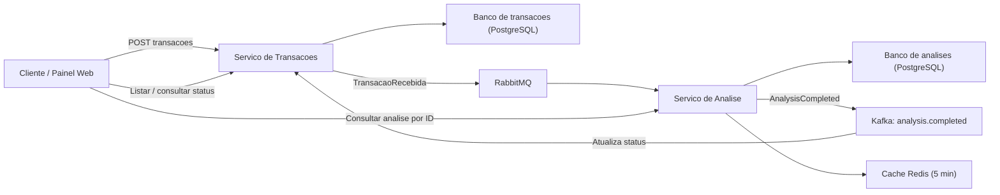

# Antifraude simplificado

Projeto didático individual para demonstrar dois serviços Spring Boot, bancos isolados, uma fila RabbitMQ, um tópico Kafka e cache Redis. A regra de análise é fictícia e serve apenas para demonstrar o fluxo; não deve ser usada para decisões financeiras reais.

## Arquitetura

**Diagrama editável:** [Abrir arquitetura no draw.io](docs/arquitetura-antifraude.drawio)



Cada serviço é dono do seu banco. O Serviço de Transações grava e publica uma mensagem no RabbitMQ; o Serviço de Análise consome a fila, grava o resultado e publica `AnalysisCompleted` no tópico Kafka `analysis.completed`. O Serviço de Transações também consome esse tópico para atualizar seu estado local e permitir que o cliente acompanhe a transação. RabbitMQ distribui o trabalho de análise; Kafka transporta o resultado. O consumidor RabbitMQ usa o ID da transação como chave única, então uma entrega repetida não cria outra análise nem publica outro resultado. A entrega da fila é **pelo menos uma vez**: uma mensagem pode ser recebida novamente.

## Microserviços

| Microserviço | Responsabilidade | Documentação |
|---|---|---|
| **Transações** | Recebe transações, publica no RabbitMQ e acompanha resultados via Kafka. | [Ver README](transaction-service/README.md) |
| **Análise** | Analisa transações; consulta o Redis e publica resultados no Kafka. | [Ver README](analysis-service/README.md) |

## Requisitos

- Docker Desktop em execução com suporte a containers Linux.
- Docker Compose v2 (`docker compose`).
- O projeto usa Java 17 dentro das imagens; não é necessário substituir o Java 8 instalado na máquina.

## Como executar

Na pasta `antifraude-simplificado`, execute:

```powershell
docker compose up --build
```

Aguarde os serviços ficarem prontos. Endpoints e ferramentas locais:

| Componente | Endereço |
|---|---|
| Painel web e Serviço de Transações | http://localhost:8081 |
| Serviço de Análise | http://localhost:8082 |
| Painel RabbitMQ | http://localhost:15672 (app / app) |
| Kafka (broker local) | localhost:9092 |
| Redis | localhost:6379 |
| Banco de transações | localhost:5433 |
| Banco de análises | localhost:5434 |

## Testes automatizados

Os testes unitários usam JUnit 5 e Mockito e cobrem a criação/publicação de transações, a regra didática de análise, a idempotência, a consulta de resultados e a atualização do status após o evento Kafka. O build Docker executa esses testes antes de empacotar cada serviço.

Para executá-los sem instalar Java ou Maven na máquina, abra o PowerShell na pasta do projeto:

```powershell
docker run --rm `
  --mount "type=bind,source=$($PWD.Path),target=/workspace" `
  --workdir /workspace `
  maven:3.9.9-eclipse-temurin-17 `
  mvn -B test
```

Uma saída com `BUILD SUCCESS` e `Tests run: 11, Failures: 0, Errors: 0` indica que os testes passaram.

### Painel de acompanhamento

Com os serviços iniciados, abra [http://localhost:8081](http://localhost:8081) para criar transações e acompanhar as 100 mais recentes. A página atualiza automaticamente a cada quatro segundos e mostra o resultado `APPROVED` ou `REVIEW`, um gráfico de distribuição dos estados e o volume por intervalos nas últimas 24 horas. O endpoint `GET /api/transacoes` fornece os dados à interface; o endpoint individual de status também está disponível em `GET /api/transacoes/{id}/status`.

Crie uma transação:

```powershell
$resposta = Invoke-RestMethod -Method Post `
  -Uri http://localhost:8081/api/transacoes `
  -ContentType 'application/json' `
  -Body '{"valor":125.50,"estabelecimento":"Loja exemplo"}'
$resposta
```

O serviço responde com o ID e o estado `RECEIVED`. A análise é assíncrona; consulte o resultado com esse ID:

```powershell
Invoke-RestMethod -Uri "http://localhost:8082/api/analises/$($resposta.id)"
```

Se a resposta ainda for `404`, aguarde a mensagem ser processada e tente novamente. Valores acima de 1.000 recebem o resultado didático `REVIEW`; os demais recebem `APPROVED`.

Para acompanhar o processamento usando o estado persistido pelo Serviço de Transações:

```powershell
Invoke-RestMethod -Uri "http://localhost:8081/api/transacoes/$($resposta.id)/status"
```

Inicialmente, `status` será `RECEIVED`. Após consumir o evento de conclusão pelo Kafka, passa a `ANALYZED` e inclui `analysisStatus` (`APPROVED` ou `REVIEW`) e o motivo. Como o fluxo é assíncrono, repita a consulta se o resultado ainda não estiver disponível.

### Verificar idempotência

1. Crie uma transação e copie o ID retornado.
2. No painel RabbitMQ, abra **Exchanges**, selecione `transactions.exchange` e publique duas vezes a mesma mensagem JSON, usando o ID copiado e os campos do evento:

   ```json
   {
     "id": "ID-DA-TRANSACAO",
     "amount": 125.50,
     "merchant": "Loja exemplo",
     "createdAt": "2026-11-11T12:00:00Z"
   }
   ```

   Use `transactions.received` como routing key.
3. Consulte `GET /api/analises/{id}`. Deve existir somente um resultado para aquele ID.

O banco também impõe unicidade pelo ID e usa `ON CONFLICT DO NOTHING`, protegendo contra entregas repetidas mesmo se houver mais de um consumidor.

### Verificar o tópico Kafka

Após processar uma transação, abra outro terminal PowerShell na pasta do projeto e execute:

```powershell
docker compose exec kafka /opt/kafka/bin/kafka-console-consumer.sh `
  --bootstrap-server localhost:9092 `
  --topic analysis.completed `
  --from-beginning
```

O consumidor de console exibe eventos JSON `AnalysisCompleted`; pressione `Ctrl+C` para encerrá-lo. O tópico é criado automaticamente quando o Serviço de Análise inicia. O Kafka usa uma partição e uma réplica porque o broker local é único; isso é adequado para demonstração, não para alta disponibilidade.

### Verificar cache

Consulte duas vezes seguidas o mesmo resultado. O endpoint usa `@Cacheable` e o Redis mantém somente resultados encontrados por 5 minutos. Resultados inexistentes não são armazenados. A gravação/atualização da análise invalida a entrada correspondente.

Para parar os serviços:

```powershell
docker compose down
```

Para apagar também os dados persistidos dos bancos (ação destrutiva):

```powershell
docker compose down -v
```

## Trade-offs e limitações atuais

As escolhas abaixo privilegiam um projeto didático executável localmente; elas não representam uma configuração pronta para produção.

| Escolha | Benefício | Custo ou limitação |
|---|---|---|
| Dois microserviços com bancos próprios | Responsabilidades e propriedade dos dados ficam claras. | Há mais componentes para iniciar e manter; a comunicação entre serviços é eventual, então a análise não fica disponível imediatamente. |
| RabbitMQ para o trabalho e Kafka para os resultados | Cada broker demonstra um papel diferente no fluxo. | Operar dois brokers aumenta a complexidade. A gravação no PostgreSQL e a publicação do evento não são atômicas; uma falha pode deixar o evento pendente ou ausente. |
| Entrega pelo menos uma vez e gravação idempotente | Reentregas do RabbitMQ não criam análises duplicadas. | O projeto ainda não configura políticas explícitas de retry com backoff nem DLQs para isolar mensagens que falham repetidamente. |
| Cache Redis com TTL de cinco minutos | Consultas repetidas podem evitar leituras ao PostgreSQL. | Redis é uma dependência adicional; sem invalidação, um resultado pode ficar desatualizado até o TTL expirar. |
| Painel com polling a cada quatro segundos | A interface é simples e acompanha o estado sem conexão persistente. | Há atraso entre atualizações e requisições periódicas. Tabela e gráficos usam somente as 100 transações mais recentes; o gráfico temporal as agrupa em intervalos de quatro horas. |
| Docker Compose local, broker único e credenciais demonstrativas | Fácil de executar e reproduzir para a apresentação. | Não há alta disponibilidade, autenticação da API nem configuração de produção; não exponha o ambiente à internet. |

## Próximos passos para evolução

Em ordem sugerida:

1. **Garantir publicação confiável de eventos:** implementar o padrão Outbox nos pontos de publicação de `TransactionReceived` e `AnalysisCompleted`, evitando divergência entre commits nos bancos e mensagens nos brokers.
2. **Recuperar falhas de processamento:** configurar retry com backoff e Dead Letter Queues (DLQ), incluindo visibilidade e procedimento de reprocessamento de mensagens inválidas.
3. **Evoluir listagem e gráficos:** adicionar paginação e filtros no endpoint de transações; mover as agregações dos gráficos para consultas no backend para que não fiquem limitadas às 100 transações recentes.
4. **Melhorar observabilidade e validação:** incluir métricas, logs estruturados, correlação de IDs e testes de integração/contrato automatizados no pipeline.
5. **Preparar para uso fora do ambiente local:** adicionar autenticação e autorização, gerir segredos fora do Compose, habilitar TLS, backups e redundância para bancos e brokers.

Esses itens são propostas futuras, não recursos implementados atualmente.

## Decisões arquiteturais (ADRs)

- [ADR-001: divisão dos serviços e bancos](docs/adr/ADR-001-servicos-e-bancos.md)
- [ADR-002: RabbitMQ, entrega e idempotência](docs/adr/ADR-002-fila-e-idempotencia.md)
- [ADR-003: cache Redis](docs/adr/ADR-003-cache.md)
- [ADR-004: tópico Kafka de resultados](docs/adr/ADR-004-topico-kafka.md)

O perfil de execução deste projeto é **A (com Docker)**. Os ADRs registram o contexto, as alternativas e as consequências das decisões adotadas.

## Apresentação

Roteiro sugerido para até 10 minutos, incluindo perguntas:

1. Mostrar o fluxo e o perfil A.
2. Criar uma transação, consultar o resultado e mostrar o evento no tópico Kafka.
3. Explicar os papéis distintos de RabbitMQ e Kafka, a idempotência, os bancos separados e o cache.
4. Apresentar os ADRs e comentar o que foi conferido manualmente e qualquer uso de IA.
