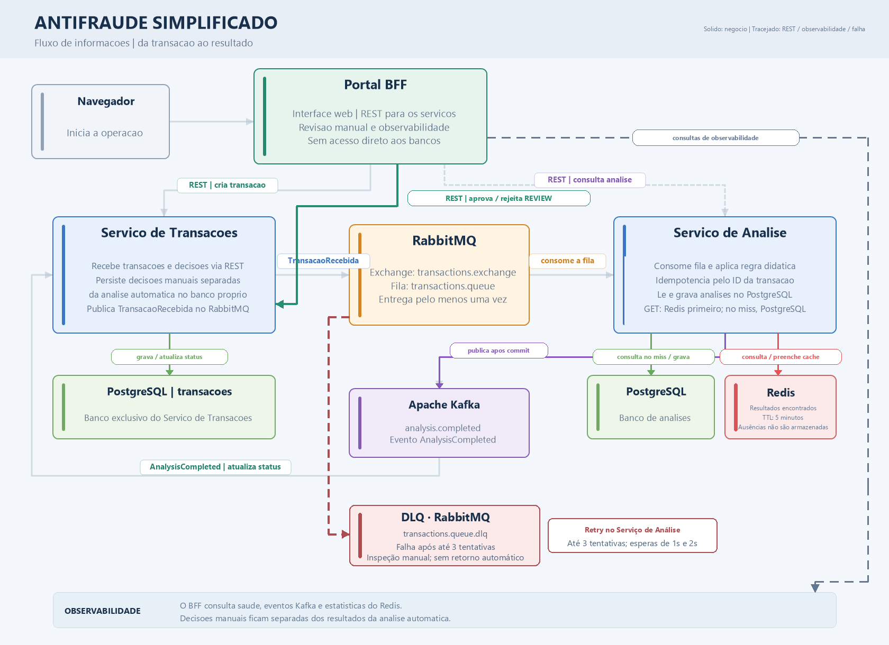
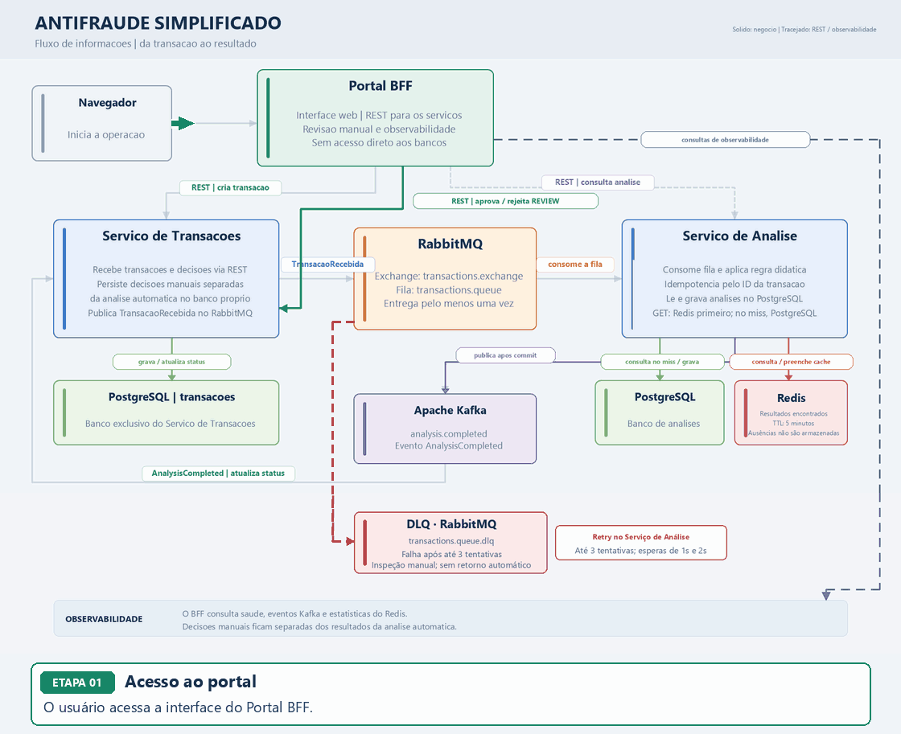
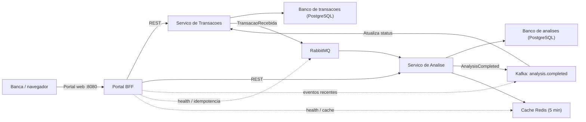
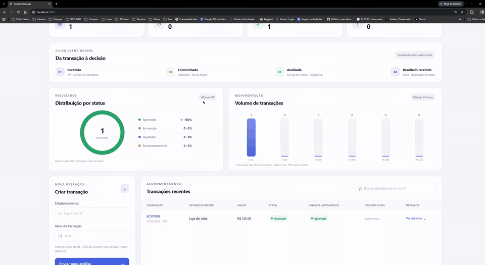
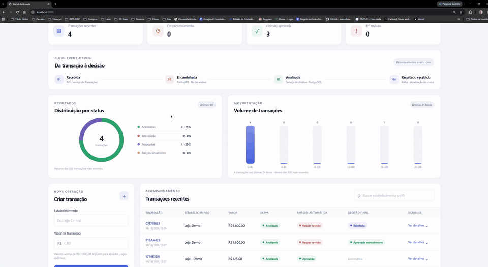
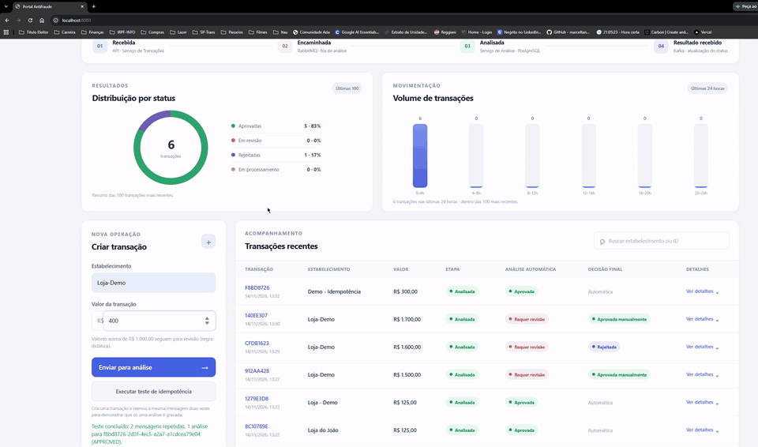
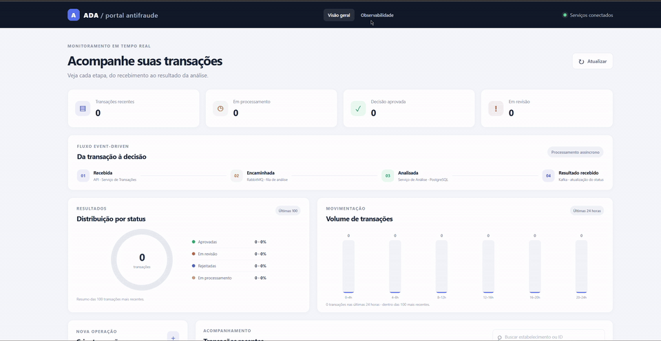

# Antifraude simplificado

Projeto didático individual para demonstrar um portal web com BFF, dois microserviços Spring Boot, bancos isolados, RabbitMQ, Kafka e Redis. A regra de análise é fictícia e serve apenas para demonstrar o fluxo; não deve ser usada para decisões financeiras reais.

## Navegação rápida

- [Arquitetura](#arquitetura)
- [Aplicações](#aplicações)
- [Demo](#demo)
- [Requisitos](#requisitos)
- [Como executar](#como-executar)
- [Testes](#testes-automatizados)
- [Trade-offs](#trade-offs-e-limitações-atuais)
- [ADRs](#decisões-arquiteturais-adrs)
- [Uso de IA](#uso-de-ia)
- [Apresentação](#apresentação)

## Arquitetura

**Diagrama editável:** [Abrir arquitetura no draw.io](docs/arquitetura-antifraude.drawio)



<details>
<summary>Assistir à animação do fluxo de informações</summary>


</details>

<details>
<summary>Ver diagrama Mermaid</summary>


</details>

O navegador acessa apenas o **Portal BFF**; o portal agrega as APIs dos microserviços e oferece verificações de saúde e operações guiadas de demonstração. O BFF não lê diretamente os bancos dos serviços. Cada microserviço é dono do seu banco. O Serviço de Transações grava e publica uma mensagem no RabbitMQ; o Serviço de Análise consome a fila, grava o resultado e publica `AnalysisCompleted` no tópico Kafka `analysis.completed`. O Serviço de Transações também consome esse tópico para atualizar seu estado local. RabbitMQ distribui o trabalho de análise; Kafka transporta o resultado. O consumidor RabbitMQ usa o ID da transação como chave única, então uma entrega repetida não cria outra análise nem publica outro resultado. A entrega da fila é **pelo menos uma vez**: uma mensagem pode ser recebida novamente.

## Aplicações

| Aplicação | Responsabilidade | Documentação |
|---|---|---|
| **Portal web / BFF** | Visão geral e operações da banca, mais uma página dedicada à saúde, eventos Kafka e cache Redis. | [Ver README](portal-service/README.md) |
| **Serviço de Transações** | Registra transações, publica no RabbitMQ, acompanha análises e registra decisões manuais de revisão. | [Ver README](transaction-service/README.md) |
| **Serviço de Análise** | Analisa transações, consulta o Redis e publica resultados no Kafka. | [Ver README](analysis-service/README.md) |

## Demo

As animações abaixo demonstram as operações do portal e a página de observabilidade, incluindo o resumo da saúde agrupado por aplicações e infraestrutura.

### Aprovação automática



**Dados de entrada:** estabelecimento `Loja - Demo`; valor `R$ 125,00`.

### Revisão manual



**Dados de entrada:** estabelecimento `Loja-Demo`; valor `R$ 1.700,00`.

**Decisão manual:** aprovar; responsável `Demo`; justificativa `Aprovação Demo`.

### Idempotência



**Dados de entrada:** estabelecimento `Demo - Idempotência`; valor `R$ 400,00`. O teste publica duas mensagens repetidas e confirma uma análise (`APPROVED`).

### Observabilidade



**Entrada:** nenhuma nova transação. A página agrupa as verificações de saúde por aplicações e infraestrutura e mostra o estado do Redis e os eventos Kafka produzidos pelos testes anteriores.

## Requisitos

- Docker Desktop em execução com suporte a containers Linux.
- Docker Compose v2 (`docker compose`).
- O projeto usa Java 17 dentro das imagens; não é necessário substituir o Java 8 instalado na máquina.

## Como executar

Na pasta `antifraude-simplificado`, execute:

```powershell
docker compose up --build
```

Aguarde os serviços ficarem prontos. Endpoints e ferramentas locais:

| Componente | Endereço |
|---|---|
| Portal web (único endereço necessário para a apresentação) | http://localhost:8080 |
| API do Serviço de Transações (diagnóstico local) | http://localhost:8081 |
| Serviço de Análise | http://localhost:8082 |
| Painel RabbitMQ | http://localhost:15672 (app / app) |
| Kafka (broker local) | localhost:9092 |
| Redis | localhost:6379 |
| Banco de transações | localhost:5433 |
| Banco de análises | localhost:5434 |

## Testes automatizados

Os testes automatizados usam JUnit 5 e Mockito e cobrem os três módulos, incluindo decisões manuais, idempotência, análise, publicação de eventos e cache: a segunda leitura usa o cache e resultados inexistentes não são armazenados. O build Docker executa esses testes antes de empacotar cada serviço.

Para executá-los sem instalar Java ou Maven na máquina, abra o PowerShell na pasta do projeto:

```powershell
docker run --rm `
  --mount "type=bind,source=$($PWD.Path),target=/workspace" `
  --workdir /workspace `
  maven:3.9.9-eclipse-temurin-17 `
  mvn -B test
```

Uma saída com `BUILD SUCCESS` e `Tests run: 17, Failures: 0, Errors: 0` indica que os testes passaram.

### API do portal (diagnóstico opcional)

Para a apresentação, use apenas a interface em [http://localhost:8080](http://localhost:8080); os exemplos de API a seguir são diagnósticos opcionais e não são necessários para operar o sistema. A página principal cria e acompanha as 100 transações mais recentes e exibe gráficos. A opção **Observabilidade** no menu abre a página separada com saúde dos serviços e dependências, eventos Kafka e informações do Redis.

Crie uma transação:

```powershell
$resposta = Invoke-RestMethod -Method Post `
  -Uri http://localhost:8080/api/transacoes `
  -ContentType 'application/json' `
  -Body '{"valor":125.50,"estabelecimento":"Loja exemplo"}'
$resposta
```

O serviço responde com o ID e o estado `RECEIVED`. A análise é assíncrona; consulte o resultado com esse ID:

```powershell
Invoke-RestMethod -Uri "http://localhost:8080/api/analises/$($resposta.id)"
```

Se a resposta ainda for `404`, aguarde a mensagem ser processada e tente novamente. Valores acima de 1.000 recebem o resultado didático `REVIEW`; os demais recebem `APPROVED`.

Para acompanhar o processamento usando o estado persistido pelo Serviço de Transações:

```powershell
Invoke-RestMethod -Uri "http://localhost:8080/api/transacoes/$($resposta.id)/status"
```

Inicialmente, `status` será `RECEIVED`. Após consumir o evento de conclusão pelo Kafka, passa a `ANALYZED` e inclui `analysisStatus` (`APPROVED` ou `REVIEW`) e o motivo. Como o fluxo é assíncrono, repita a consulta se o resultado ainda não estiver disponível.

No portal, **Executar teste de idempotência** cria uma transação, publica novamente a mesma mensagem duas vezes e confirma que há uma única análise. A página **Observabilidade** reúne saúde dos serviços e dependências, eventos recentes do Kafka e estado e uso do cache Redis. Não é necessário abrir os painéis de infraestrutura durante a apresentação.

Transações com análise `REVIEW` oferecem ações **Aprovar** e **Rejeitar**. A decisão manual, responsável e justificativa são registradas separadamente do resultado automático, que permanece preservado. Este fluxo não tem autenticação: o nome do responsável é informado pelo operador e serve apenas à demonstração local.

Para parar os serviços:

```powershell
docker compose down
```

Para apagar também os dados persistidos dos bancos (ação destrutiva):

```powershell
docker compose down -v
```

## Trade-offs e limitações atuais

As escolhas abaixo privilegiam um projeto didático executável localmente; elas não representam uma configuração pronta para produção.

| Escolha | Benefício | Custo ou limitação |
|---|---|---|
| Portal BFF separado dos microserviços | Dá à banca uma interface única e mantém o portal isolado das APIs internas e dos bancos. | É mais um serviço para executar e manter; não há autenticação ou autorização e ele deve permanecer restrito ao ambiente local. |
| Dois microserviços com bancos próprios | Responsabilidades e propriedade dos dados ficam claras. | Há mais componentes para iniciar e manter; a comunicação entre serviços é eventual, então a análise não fica disponível imediatamente. |
| RabbitMQ para o trabalho e Kafka para os resultados | Cada broker demonstra um papel diferente no fluxo. | Operar dois brokers aumenta a complexidade. A gravação no PostgreSQL e a publicação do evento não são atômicas; uma falha pode deixar o evento pendente ou ausente. |
| Entrega pelo menos uma vez e gravação idempotente | Reentregas do RabbitMQ não criam análises duplicadas. | O projeto ainda não configura políticas explícitas de retry com backoff nem DLQs para isolar mensagens que falham repetidamente. |
| Cache Redis com TTL de cinco minutos | Consultas repetidas podem evitar leituras ao PostgreSQL. | Redis é uma dependência adicional; sem invalidação, um resultado pode ficar desatualizado até o TTL expirar. |
| Painel com polling a cada quatro segundos | A interface é simples e acompanha o estado sem conexão persistente. | Há atraso entre atualizações e requisições periódicas. Tabela e gráficos usam somente as 100 transações mais recentes; o gráfico temporal as agrupa em intervalos de quatro horas. |
| Decisão manual para análises `REVIEW` | Permite demonstrar uma revisão humana sem apagar a classificação automática. | Não há autenticação nem identidade verificada do operador; responsável e justificativa são informados pelo usuário. |
| Docker Compose local, broker único e credenciais demonstrativas | Fácil de executar e reproduzir para a apresentação. | Não há alta disponibilidade, autenticação da API nem configuração de produção; não exponha o ambiente à internet. |

## Próximos passos para evolução

Em ordem sugerida:

1. **Garantir publicação confiável de eventos:** implementar o padrão Outbox nos pontos de publicação de `TransactionReceived` e `AnalysisCompleted`, evitando divergência entre commits nos bancos e mensagens nos brokers.
2. **Recuperar falhas de processamento:** configurar retry com backoff e Dead Letter Queues (DLQ), incluindo visibilidade e procedimento de reprocessamento de mensagens inválidas.
3. **Evoluir listagem e gráficos:** adicionar paginação e filtros no endpoint de transações; mover as agregações dos gráficos para consultas no backend para que não fiquem limitadas às 100 transações recentes.
4. **Melhorar observabilidade e validação:** incluir métricas, logs estruturados, correlação de IDs e testes de integração/contrato automatizados no pipeline.
5. **Preparar para uso fora do ambiente local:** adicionar autenticação e autorização no portal e nas decisões manuais, gerir segredos fora do Compose, habilitar TLS, backups e redundância para bancos e brokers.

Esses itens são propostas futuras, não recursos implementados atualmente.

## Decisões arquiteturais (ADRs)

- [ADR-001: divisão dos serviços e bancos](docs/adr/ADR-001-servicos-e-bancos.md)
- [ADR-002: RabbitMQ, entrega e idempotência](docs/adr/ADR-002-fila-e-idempotencia.md)
- [ADR-003: cache Redis](docs/adr/ADR-003-cache.md)
- [ADR-004: tópico Kafka de resultados](docs/adr/ADR-004-topico-kafka.md)

O perfil de execução deste projeto é **A (com Docker)**. Os ADRs registram o contexto, as alternativas e as consequências das decisões adotadas.

## Uso de IA

Ferramentas de IA generativa, incluindo o GitHub Copilot, foram usadas como apoio ao desenvolvimento e à documentação, inclusive na evolução do painel de observabilidade. O projeto foi conferido com `mvn -B test`, execução em Docker Compose a partir de volumes vazios e testes dos fluxos de aprovação automática, revisão manual, idempotência, Kafka, Redis e saúde dos serviços. O autor é responsável por revisar e compreender o código, as decisões e os resultados antes da entrega.

## Apresentação

Roteiros detalhados: [apresentação](apresentacao.md) e [passo a passo da demonstração](passo-a-passo.md).

Roteiro sugerido para até 10 minutos, incluindo perguntas:

1. Mostrar o fluxo e o perfil A.
2. No portal, criar transações de resultado `APPROVED` e `REVIEW`, decidir um caso de revisão e executar o teste guiado de idempotência.
3. Abrir **Observabilidade** pelo menu para mostrar saúde dos serviços, eventos Kafka recentes e estado do Redis; explicar os papéis distintos dos brokers e dos bancos separados.
4. Apresentar os ADRs e explicar o uso de IA e as validações realizadas (ver [Uso de IA](#uso-de-ia)).
