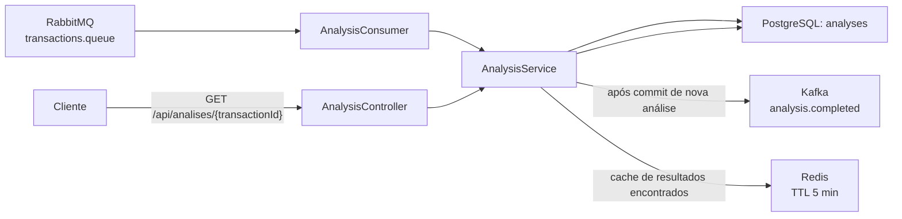

# Serviço de Análise

## Objetivo

Consumir transações do RabbitMQ, aplicar a regra didática de análise, persistir um resultado no PostgreSQL próprio, disponibilizar a consulta por ID com cache Redis e publicar resultados novos no tópico Kafka.

Este serviço não acessa o banco do Serviço de Transações. A regra de classificação é fictícia e serve apenas para demonstrar o fluxo; não deve ser usada em decisões financeiras reais.

## Arquitetura e fluxo



1. `AnalysisConsumer` recebe a mensagem `TransactionReceived` da fila `transactions.queue`.
2. `AnalysisService` classifica a transação: valores **maiores que 1.000,00** recebem `REVIEW`; valores menores ou iguais recebem `APPROVED`.
3. A análise é inserida no banco com o ID da transação como chave única. `ON CONFLICT DO NOTHING` torna a gravação idempotente.
4. Se a análise for nova, o serviço emite `AnalysisCompleted`; `AnalysisEventPublisher` publica o evento no Kafka após o commit da transação.
5. O endpoint de consulta busca a análise por ID. Resultados encontrados podem ser armazenados no Redis por cinco minutos; resultados inexistentes não são armazenados.

RabbitMQ distribui o trabalho para análise. Kafka publica o fluxo de resultados; o Serviço de Transações consome `analysis.completed` para atualizar o estado local. Consumidores adicionais para auditoria ou relatórios são uma evolução futura.

Se o processamento de uma mensagem falhar, o consumidor tenta até três vezes no total, com esperas de 1 e 2 segundos. Após esgotar as tentativas, o RabbitMQ encaminha a mensagem para a fila durável `transactions.queue.dlq`. Ela não é reprocessada automaticamente: deve ser inspecionada antes de uma eventual ação manual.

## API

### Consultar análise

`GET /api/analises/{transactionId}`

- Retorna o resultado quando encontrado.
- Retorna HTTP `404 Not Found` enquanto a mensagem ainda não tiver sido processada ou se não houver análise para o ID.

Exemplo de resposta:

```json
{
  "transactionId": "UUID-DA-TRANSACAO",
  "amount": 125.50,
  "merchant": "Loja exemplo",
  "status": "APPROVED",
  "reason": "Valor dentro do limite didático configurado",
  "analyzedAt": "2026-11-11T12:00:00Z"
}
```

### Consultar quantidade de análises por transação

`GET /api/analises/{transactionId}/idempotency-count`

Retorna quantos resultados estão persistidos para o ID, usado pelo teste guiado de idempotência no Portal BFF. Para uma mensagem repetida, o valor esperado é `1`.

## Estrutura de pastas

```text
analysis-service/
├── Dockerfile
├── pom.xml
├── README.md
└── src/
    ├── main/
    │   ├── java/br/com/ada/analysis/
    │   │   ├── AnalysisApplication.java
    │   │   ├── AnalysisCompleted.java
    │   │   ├── AnalysisConsumer.java
    │   │   ├── AnalysisController.java
    │   │   ├── AnalysisEventPublisher.java
    │   │   ├── AnalysisRepository.java
    │   │   ├── AnalysisResponse.java
    │   │   ├── AnalysisResult.java
    │   │   ├── AnalysisService.java
    │   │   ├── KafkaConfiguration.java
    │   │   ├── RabbitConfiguration.java
    │   │   └── TransactionReceived.java
    │   └── resources/
    │       └── application.yml
    └── test/
        └── java/br/com/ada/analysis/
            └── AnalysisServiceTest.java
```

## Tecnologias e configuração

- Java 17 e Spring Boot.
- Spring Web para a API de consulta.
- Spring Data JPA e PostgreSQL para persistência.
- Spring AMQP e RabbitMQ para consumo da fila.
- Spring Kafka para publicação do evento de análise.
- Spring Cache e Redis para cache de consulta, com TTL de cinco minutos.
- Porta HTTP: `8082`.
- Porta interna de health checks: `8182` (não publicada no host pelo Compose).
- Banco local no Compose: `analyses`, publicado na porta `5434`.
- Tópico Kafka: `analysis.completed`, com uma partição e uma réplica no ambiente local.

Configurações padrão e variáveis de ambiente estão em `src/main/resources/application.yml`. Em execução local, os serviços de infraestrutura são fornecidos pelo Docker Compose da raiz; os passos completos estão no [README principal](../README.md).

## Testes

`AnalysisServiceTest` cobre a classificação nos limites da regra didática, a publicação somente para uma nova análise e as consultas encontradas e inexistentes. O build da imagem Docker executa os testes Maven antes de empacotar o serviço. O teste opcional `RabbitRetryIntegrationTest` usa um RabbitMQ isolado para verificar as tentativas e o encaminhamento à DLQ; consulte as instruções no [README principal](../README.md#testes-automatizados).

## Limitações conhecidas

A publicação no Kafka ocorre após o commit, mas não é atômica com a gravação no PostgreSQL. Uma falha entre o commit e a publicação pode deixar o evento faltando; o padrão Outbox é uma evolução futura. O broker Kafka local usa um único nó e não oferece alta disponibilidade.
