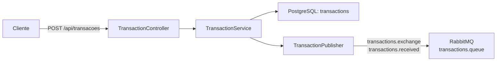

# Serviço de Transações

## Objetivo

Receber solicitações de transação pela API, persistir cada uma no banco PostgreSQL que pertence a este serviço e publicar um evento no RabbitMQ para processamento assíncrono pelo Serviço de Análise.

Este serviço é responsável pela entrada e pelos dados originais da transação. Não acessa o banco do Serviço de Análise, o Redis nem o Kafka.

## Arquitetura e fluxo



1. `POST /api/transacoes` recebe valor e estabelecimento; ambos são validados.
2. `TransactionService` gera um UUID e registra a transação no banco próprio.
3. Após salvar, `TransactionPublisher` serializa e publica `TransactionReceived` no exchange `transactions.exchange`, com a routing key `transactions.received`.
4. A API responde com HTTP `202 Accepted`, o ID e o estado `RECEIVED`. A análise é assíncrona e pode ainda não estar disponível.

O RabbitMQ oferece entrega **pelo menos uma vez**; portanto, o consumidor precisa lidar com mensagens repetidas. A garantia de não duplicar análises é implementada pelo Serviço de Análise.

## API

### Criar transação

`POST /api/transacoes`

Exemplo de requisição:

```json
{
  "valor": 125.50,
  "estabelecimento": "Loja exemplo"
}
```

`valor` deve ser positivo e `estabelecimento` não pode estar em branco. Exemplo de resposta:

```json
{
  "id": "UUID-GERADO",
  "status": "RECEIVED"
}
```

## Estrutura de pastas

```text
transaction-service/
├── Dockerfile
├── pom.xml
├── README.md
└── src/
    ├── main/
    │   ├── java/br/com/ada/transactions/
    │   │   ├── RabbitConfiguration.java
    │   │   ├── Transaction.java
    │   │   ├── TransactionApplication.java
    │   │   ├── TransactionController.java
    │   │   ├── TransactionPublisher.java
    │   │   ├── TransactionReceived.java
    │   │   ├── TransactionRepository.java
    │   │   ├── TransactionRequest.java
    │   │   ├── TransactionResponse.java
    │   │   └── TransactionService.java
    │   └── resources/
    │       └── application.yml
    └── test/
        └── java/br/com/ada/transactions/
            └── TransactionServiceTest.java
```

## Tecnologias e configuração

- Java 17 e Spring Boot.
- Spring Web e Bean Validation para a API.
- Spring Data JPA e PostgreSQL para persistência.
- Spring AMQP e RabbitMQ para publicação assíncrona.
- Porta HTTP: `8081`.
- Banco local no Compose: `transactions`, publicado na porta `5433`.
- Exchange, fila e routing key: `transactions.exchange`, `transactions.queue` e `transactions.received`.

Configurações padrão e variáveis de ambiente estão em `src/main/resources/application.yml`. Em execução local, os serviços de infraestrutura são fornecidos pelo Docker Compose da raiz; os passos completos estão no [README principal](../README.md).

## Testes

`TransactionServiceTest` verifica a persistência e publicação do evento correspondente e que uma falha ao salvar impede a publicação. O build da imagem Docker executa os testes Maven antes de empacotar o serviço.
