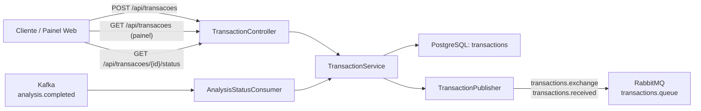

# Serviço de Transações

## Objetivo

Receber solicitações de transação pela API, persistir cada uma no banco PostgreSQL que pertence a este serviço, publicar um evento no RabbitMQ para processamento assíncrono pelo Serviço de Análise e oferecer um painel web para acompanhar o fluxo.

Este serviço é responsável pela entrada e pelos dados originais da transação. Não acessa o banco do Serviço de Análise nem o Redis. Ele consome os eventos de análise concluída do Kafka para atualizar o estado local da transação.

## Arquitetura e fluxo



1. `POST /api/transacoes` recebe valor e estabelecimento; ambos são validados.
2. `TransactionService` gera um UUID e registra a transação no banco próprio.
3. Após salvar, `TransactionPublisher` serializa e publica `TransactionReceived` no exchange `transactions.exchange`, com a routing key `transactions.received`.
4. A API responde com HTTP `202 Accepted`, o ID e o estado `RECEIVED`. A análise é assíncrona e pode ainda não estar disponível.
5. Após o Serviço de Análise publicar `AnalysisCompleted` no Kafka, `AnalysisStatusConsumer` atualiza a transação no banco deste serviço. O endpoint de acompanhamento passa a retornar `ANALYZED` e o resultado (`APPROVED` ou `REVIEW`).

O RabbitMQ oferece entrega **pelo menos uma vez**; portanto, o consumidor precisa lidar com mensagens repetidas. A garantia de não duplicar análises é implementada pelo Serviço de Análise.

## API

### Criar transação

`POST /api/transacoes`

Exemplo de requisição:

```json
{
  "valor": 125.50,
  "estabelecimento": "Loja exemplo"
}
```

`valor` deve ser positivo e `estabelecimento` não pode estar em branco. Exemplo de resposta:

```json
{
  "id": "UUID-GERADO",
  "status": "RECEIVED"
}
```

### Listar transações recentes

`GET /api/transacoes`

Retorna as 100 transações mais recentes, incluindo valor, estabelecimento, timestamps e estado/análise disponíveis. O painel usa esse endpoint para atualizar a tabela e os indicadores.

### Consultar estado e resultado da transação

`GET /api/transacoes/{transactionId}/status`

- Antes de o evento Kafka ser consumido, `status` é `RECEIVED`; `analysisStatus` e `analyzedAt` são `null`.
- Após o evento ser processado, `status` passa a `ANALYZED`; `analysisStatus` contém `APPROVED` ou `REVIEW`.
- Retorna HTTP `404 Not Found` se o ID não existir no banco deste serviço.

Exemplo após a análise:

```json
{
  "id": "UUID-DA-TRANSACAO",
  "amount": 125.50,
  "merchant": "Loja exemplo",
  "status": "ANALYZED",
  "analysisStatus": "APPROVED",
  "analysisReason": "Valor dentro do limite didático configurado",
  "createdAt": "2026-11-13T12:00:00Z",
  "analyzedAt": "2026-11-13T12:00:01Z"
}
```

### Painel web

Abra [http://localhost:8081](http://localhost:8081) com o Docker Compose em execução. O painel permite criar transações, buscar por estabelecimento ou ID, acompanhar estados/resultados e visualizar gráficos de distribuição por status e volume por intervalos nas últimas 24 horas. A lista e os gráficos são atualizados automaticamente a cada quatro segundos e representam as 100 transações mais recentes.

## Estrutura de pastas

```text
transaction-service/
├── Dockerfile
├── pom.xml
├── README.md
└── src/
    ├── main/
    │   ├── java/br/com/ada/transactions/
    │   │   ├── RabbitConfiguration.java
    │   │   ├── Transaction.java
    │   │   ├── TransactionApplication.java
    │   │   ├── TransactionController.java
    │   │   ├── AnalysisCompleted.java
    │   │   ├── AnalysisStatusConsumer.java
    │   │   ├── TransactionPublisher.java
    │   │   ├── TransactionReceived.java
    │   │   ├── TransactionRepository.java
    │   │   ├── TransactionRequest.java
    │   │   ├── TransactionResponse.java
    │   │   ├── TransactionStatusResponse.java
    │   │   └── TransactionService.java
    │   └── resources/
    │       ├── static/
    │       │   ├── app.js
    │       │   ├── index.html
    │       │   └── styles.css
    │       └── application.yml
    └── test/
        └── java/br/com/ada/transactions/
            └── TransactionServiceTest.java
```

## Tecnologias e configuração

- Java 17 e Spring Boot.
- Spring Web e Bean Validation para a API.
- Spring Data JPA e PostgreSQL para persistência.
- Spring AMQP e RabbitMQ para publicação assíncrona.
- Spring Kafka para consumir os eventos de análise concluída.
- Porta HTTP: `8081`.
- Banco local no Compose: `transactions`, publicado na porta `5433`.
- Exchange, fila e routing key: `transactions.exchange`, `transactions.queue` e `transactions.received`.

Configurações padrão e variáveis de ambiente estão em `src/main/resources/application.yml`. Em execução local, os serviços de infraestrutura são fornecidos pelo Docker Compose da raiz; os passos completos estão no [README principal](../README.md).

## Testes

`TransactionServiceTest` verifica a persistência/publicação de eventos, listagem e acompanhamento do resultado, além de assegurar que uma falha ao salvar impede a publicação. O build da imagem Docker executa os testes Maven antes de empacotar o serviço.
